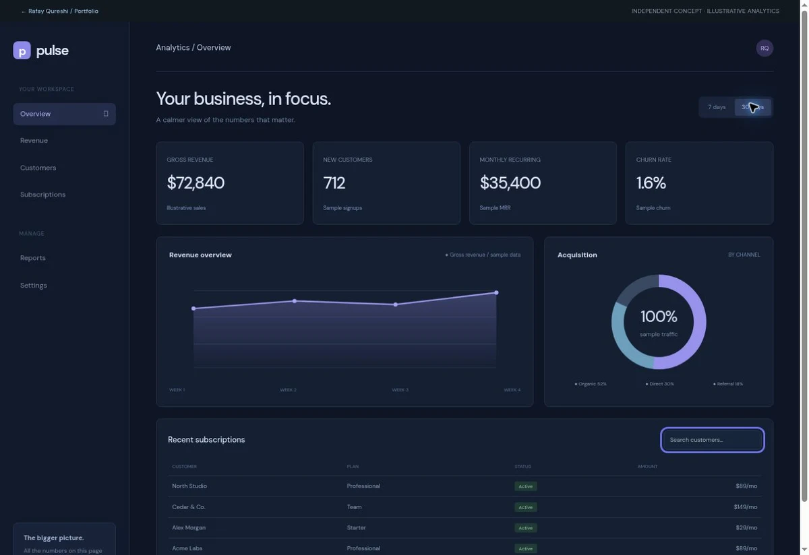

# Pulse — SaaS Analytics

An interactive analytics dashboard using coherent illustrative report data.



## What to try

- Switch between 7-day and 30-day reports
- Inspect the SVG revenue chart
- Search sample subscriptions
- Read accessible chart summaries

## Run locally

```bash
python -m http.server 8000
```

Open http://localhost:8000. No build step, account, API key or package installation is required.

## Stack

HTML, CSS and JavaScript. Google Fonts have system-font fallbacks.

## Project status

Original frontend concept by Muhammad Rafay Qureshi. All revenue, customer and subscription data is illustrative. No personal data is sent to a server.

## Implementation notes

| File | Responsibility |
| --- | --- |
| index.html | Semantic page structure and the project-specific interface |
| demo.css | Responsive layout and shared visual system |
| demo.js | Browser interaction controller |
| docs/preview.webp | Screenshot of the implemented interface |
| assets/favicon.svg | Project icon |

The page selects its interaction module through its data-demo attribute. Shared assets are included locally, so this repository can be served on its own. The interface uses sample data and does not require a backend service.

## Portfolio

[View the portfolio source](https://github.com/rafayyqureshi/rafay-portfolio) · [GitHub profile](https://github.com/rafayyqureshi)
